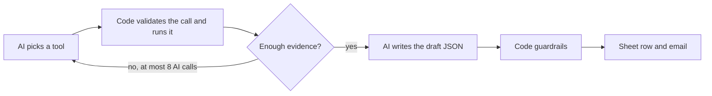
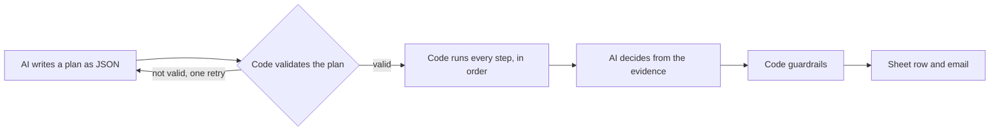
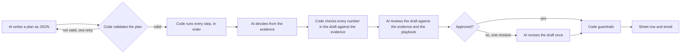

# Crypto Watch Agent

Densight Labs AI Masterclass, Assignments 2 and 3: Build a Crypto Watch Agent.

**This project is for education only and is not financial advice.**

## Question and watchlist

**Monitoring question**

> Across BTC/USD, ETH/USD and XRP/USD, what has changed in the latest completed daily market data, which movements or relationships are unusual compared with each asset's historical behaviour, what do trends, volatility, volume, relative strength and cross-asset relationships indicate, and what evidence-based forward scenarios, uncertainty levels, risk flags and invalidation conditions should be monitored?

**What the agent runs on each day.** The prompt sent to the AI is the narrower question in `QUESTION` in `agent.py`, because the agent can only answer from the data and rules it has:

> Is BTC, ETH or XRP showing unusual volatility, distance from its 30-day average or drawdown in its latest completed daily candle compared with its own history, and is the data reliable enough to say so?

**Coverage of the monitoring question today.** This table says what the code does, so the question is not claimed to be answered more than it is. Only the first three price measures can raise an alert. Everything else is described as context and never alerts on its own (a guardrail in code, see below).

| Part of the question | Status | How |
|---|---|---|
| What has changed in the latest completed daily data | Implemented | Latest completed candle only (today's unfinished candle is dropped): last close, daily return, the price metrics and the context metrics. No day-over-day comparison of ranks |
| Unusual compared with each asset's own history | Implemented | Each metric is ranked (percentile, 0 to 100) against that coin's own history, up to about 700 days |
| Trends | Implemented as context | Label `up`, `down` or `mixed` from the 30- and 60-day changes and the close against its 30-day average. Also the distance from the 30-day average, which is an alert metric |
| Volatility | Implemented | 30-day daily volatility (sample standard deviation of 30 daily returns) |
| Volume | Implemented as context | Today's Kraken volume divided by the mean of the previous 30 days, ranked against that ratio's own history. It is Kraken volume in the coin, not market-wide volume |
| Relative strength | Implemented as context | A coin's 30-day return minus the group mean, ranked against its own history (unusual at either end) |
| Cross-asset relationships | Implemented as context | Rolling 30-day correlation of daily returns for each pair, ranked against the pair's own history (tool `get_cross_asset_summary`) |
| Liquidity | Implemented as context (new, free source) | Spread and order-book depth within 1% of the mid price (or the narrower range both sides of the book cover, which is reported), from Kraken's public order book (tool `get_market_context`) |
| Derivatives positioning | Implemented as description only | Funding rate (who pays whom) and open interest of the perpetual futures contract, from Kraken Futures. Never flagged and never an alert, because there is no stored history to rank against |
| Implied volatility | Implemented as context for BTC and ETH | Deribit's DVOL index, ranked against the past year. XRP has no such index and is reported as unavailable |
| Market-wide volume and a second price | Implemented as context, needs the free CoinGecko Demo key | 24-hour volume across exchanges against its 30-day average, ranked against its own history, and a price cross-check against Kraken's mid price. Without the key these fields say "not configured" |
| Market sentiment | Implemented as context | The Fear and Greed Index (alternative.me), one value for the whole market |
| Forward scenarios | Conditional watch scenarios, not predictions | The brief lists conditions that can be observed (stress persists, back to normal, a new breach), what the agent does in each, and what would invalidate it. No probability, no price forecast, no advice |
| Uncertainty levels | Implemented as stated limits | Ranks show how unusual a value is. The brief also shows how often each coin reached the alert rank in its own history, and the approximations in the trigger levels. No confidence intervals |
| Risk flags | Implemented | Alert (rank 95 or higher), near threshold (90 to below 95), unusual volume, relative strength or correlation (context), and data unavailable |
| Invalidation conditions | Implemented for the watch scenarios | Each scenario states what would show it no longer applies, such as a rank falling below 90 or an invalid candle |

Three limits stay. The agent makes no forecast and gives no advice, by design: the project is for education only, and the playbook and the code forbid both. Trigger levels in the brief are closed-form values worked out from the coin's own history, not targets. Trend, volume, relative strength, correlation and the new market context have no backtest of their own yet. The new context sources have only been tested offline on sample replies so far (see "Free data sources for market context").

| Coin | Kraken pair | Kraken result key |
|---|---|---|
| Bitcoin (BTC) | `XBTUSD` | `XXBTZUSD` |
| Ethereum (ETH) | `ETHUSD` | `XETHZUSD` |
| XRP | `XRPUSD` | `XXRPZUSD` |

### Kraken API used for the data

- **Endpoint:** `GET https://api.kraken.com/0/public/OHLC` (Kraken REST API, "Get OHLC Data"), with `pair` set to `XBTUSD`, `ETHUSD` or `XRPUSD` and `interval=1440` for daily candles. It is a public endpoint: no API key and no account are needed.
- **Each candle:** `[time, open, high, low, close, vwap, volume, count]`. The agent uses `time`, `close` and `volume`.
- **Depth:** Kraken returns up to 720 of the most recent candles, which is why the history used for ranking is about 700 days.
- **Unfinished candle:** the last entry in the reply is the current, not-yet-committed day. The agent drops it, so every number is from a completed UTC day.
- **Checks in code:** the reply must contain exactly the expected result key (`XXBTZUSD`, `XETHZUSD` or `XXRPZUSD`), every row must be 8 values with a positive close, the days must be consecutive with no gap, and the latest completed candle must be yesterday. Anything else is an error, never a guess. A failed request is tried up to 3 times.
- **Pair names:** the result keys were confirmed against Kraken's `GET /0/public/AssetPairs` endpoint (`XRPUSD` is stored under `XXRPZUSD`).
- **Documentation:** [Get OHLC Data](https://docs.kraken.com/api/docs/rest-api/get-ohlc-data) and [Historical data](https://docs.kraken.com/exchange/guides/general/historical-data).

### Free data sources for market context

Only free public sources are used. No paid plan and no paid key is needed anywhere. The one optional key is CoinGecko's free Demo key, stored as the GitHub secret `COINGECKO_API_KEY`. Without it the CoinGecko fields say "not configured" and everything else still works.

| Source | What it gives | Key | Used for |
|---|---|---|---|
| Kraken order book, `GET /0/public/Depth` | Bids and asks, up to 500 levels each side | none | Spread and depth around the mid price (band of 1%, or narrower when the fetched book does not reach 1%; both sides use the same band) |
| Kraken Futures, `GET /derivatives/api/v3/tickers` | Perpetual contracts: funding rate, open interest, mark price | none | Funding rate and who pays it, open interest |
| Deribit, `public/get_volatility_index_data` | DVOL, an implied volatility index, for BTC and ETH (one year of daily values) | none | Implied volatility and its rank over the past year |
| CoinGecko, `/coins/markets` and `/coins/{id}/market_chart` | Price, 24-hour volume, a year of daily volumes | free Demo key, header `x-cg-demo-api-key` | Market-wide volume ratio and rank, price cross-check |
| alternative.me, `/fng/` | Fear and Greed Index, 0 to 100 | none | Market-wide sentiment |

- **Fail-soft.** Every source is read by `sources.py`, which never raises. A source that is down, slow, rate limited or returns something unexpected becomes `{"unavailable": "<short reason>"}` for that field only. The agent is told to say "unavailable" and never to estimate it. The error text never contains a URL, a header or a key (`test_an_error_never_contains_the_url_or_the_key`).
- **Context only.** None of this can raise an alert. Funding, open interest and liquidity have no stored history, so they are described and never flagged. Implied volatility rank and market-wide volume rank reuse the alert rank of 95, and the sentiment index is flagged as extreme at 24 or lower and 76 or higher (own convention). The price cross-check flags a gap above 1% between Kraken and CoinGecko, and it never blocks an alert, because aggregated prices lag in fast markets.
- **Attribution.** CoinGecko and alternative.me ask for attribution. The brief's footer carries it, with links.
- **Limits.** CoinGecko's Demo plan has a monthly call cap and a per-minute limit (each run makes 4 CoinGecko calls: one markets call and one volume history per coin, and both the daily run and the brief make them, so about 8 a day, far below the Demo plan's monthly cap). The sources can change their format or limits at any time, which is why each one has its own check in `python agent.py --check-sources` and in the manual `Data sources check` workflow.
- **Verification status.** Verified offline: every parser against sample replies written to the providers' documented shapes, the fail-soft paths, the rank maths against the agent's own, and the Sheet row width. **Verified live on 2026-11-21** with the manual `Data sources check` workflow ([run 44842220066](https://github.com/rizwana-qa/crypto-watch-agent/actions/runs/44842220066), 0 required sources failed, using the free CoinGecko Demo key): all five sources answered for all three coins. What the run settled: Kraken's `relativeFundingRate` is the absolute `fundingRate` divided by the mark price (BTC 0.6995 / 58,930 = 1.187e-5 against 1.189e-5; ETH and XRP agree the same way), so it is a fraction of the price, and Kraken's support pages describe funding as set for a 1-hour period, so the code reports it as percent per hour. Open interest is in coins for the linear `PF_` contracts (BTC 2,339 coins is about $138M, plausible for Kraken Futures). The XRP contract is `PF_XRPUSD`. CoinGecko's id for XRP is `ripple` (its market chart answered). Today's partial day is dropped, so the latest volume day used is yesterday's stamp, and CoinGecko stamps its daily points at 00:00 UTC, so treat `as_of` as accurate to about one day. The live run also found a flaw that the sample replies could not show: Kraken's default 100 order-book levels did not reach 1% from the price for any coin, so the depth was labelled "within 1%" but covered less. The code now fetches up to 500 levels, uses one band for both sides (1% or the narrower range the book covers) and reports it. Re-run live after that fix ([run 44842558674](https://github.com/rizwana-qa/crypto-watch-agent/actions/runs/44842558674)): the band is the full 1% for all three coins, so bid and ask depth are comparable. The full agent has not yet been run live with the new tools, and scenarios 8 to 20 have not been run with the real AI.
- **Documentation:** [Kraken Depth](https://docs.kraken.com/api/docs/rest-api/get-order-book), [Kraken Futures tickers](https://docs.kraken.com/api/docs/futures-api/trading/get-tickers), [Deribit volatility index](https://docs.deribit.com/api-reference/market-data/public-get_volatility_index_data), [CoinGecko API](https://docs.coingecko.com/), [Fear and Greed API](https://alternative.me/crypto/api/).

## How it works

Each day the agent looks at three coins and decides whether anything deserves an alert.

**What the AI does.** It chooses which tools to call, reads their results, searches `playbook.md` for the rule that applies, and writes a draft decision as JSON: `alert`, `coins`, `message`, `sources`, `reasoning`. It only recommends.

**What the code does.** It fetches and validates the Kraken data, calculates every number, ranks each number against the coin's own history, runs every tool, checks the AI's answer, blocks anything that breaks a rule, writes the Sheet row and triggers the email. The AI never fetches data and never runs a tool.

```
Kraken -> market tool, cross-asset tool (code) --\
Free sources -> market context tool (code) ------\
Sheet  -> memory tool (code) ---------------------> AI (Groq) -> draft JSON -> [reviewer] -> GUARDRAILS (code) -> Sheet row + email
playbook.md -> search tool (code) ---------------/
```

### The six tools

| Tool | What it returns | Alerts? |
|---|---|---|
| `get_market_summary(coin)` | Last close, daily return, volatility, distance from the 30-day average, drawdown, each with its rank; plus trend, volume and the flags | Only the three price ranks can alert |
| `get_cross_asset_summary()` | Relative strength and pairwise correlation, each ranked, and the flags | Context only |
| `get_market_context()` | Liquidity, funding rate and open interest, implied volatility, market-wide volume, a second price, the fear and greed index, and the flags. Any field may say "unavailable" | Context only |
| `get_alert_history_stats()` | How often each coin was at the alert rank in its own history: days ranked, alert days, share, episodes, latest alert day | Context only |
| `get_recent_decisions()` | The last 7 saved decisions from the Sheet (to avoid repeat alerts) | No |
| `search_playbook(query)` | The matching playbook sections, for the rules and the wording | No |

**Model.** The AI is `openai/gpt-oss-120b` on Groq (set by `MODEL` in `agent.py`, or the `GROQ_MODEL` variable). The first choice, `llama-3.3-70b-versatile`, was shut down by Groq on 16 August 2026, so the first live run failed with `model_not_found`. The free Groq tier allows 8,000 tokens per minute and 200,000 per day, so the agent waits and retries when it is rate limited.

## The four versions and the loop behind them

Four versions can be run from the same code: **Agent loop**, **Agent loop + reviewer**, **Planner** and **Planner + reviewer**. Choose with `--mode agent|planner` and `--reviewer off|on`. The daily workflow runs the Agent loop with the reviewer off. In every version the AI only recommends, and the code has the last word.

### Agent loop (daily version)



### Planner



### Planner + reviewer (the plan, decide and review loop)



How this differs from a generic "plan, act, reflect" loop, so the diagram is not read as more than the code does:

- **Plan limit.** A plan may have at most `MAX_PLAN_STEPS = 12` steps, not 4. The plan prompt requires one market step for each of the three coins, one cross-asset step, one market-context step, one alert-history-stats step, one history step and the playbook searches, so a complete plan has at least 8. The agent loop's own limit is `MAX_STEPS = 12` AI calls (a call can contain several tool calls). The code enforces the maximum, the allowed tools, the watchlist coins, the exact keys (`tool`, `args`, `reason`) and a non-empty reason. It does not enforce which steps a plan contains, so a plan can omit a rule search (see the results below).
- **One review, one revision.** The reviewer reads the draft once. If it finds problems, the AI revises once (`MAX_REVISIONS = 1`). The revised draft is not reviewed again. It goes straight to the code guardrails.
- **The reviewer never blocks the job.** A broken or failed reviewer reply keeps the draft, and the guardrails still apply. The reviewer has two parts: a code check (`unsupported_numbers`) that finds numbers in the draft which appear nowhere in the evidence, and an AI check of the playbook rules, repeat alerts and advice wording.
- **Final word.** `apply_guardrails` runs last, in code, in every version. The AI cannot talk its way past it.

## Run it from a fresh clone

1. Python 3.12 or newer (the workflows use 3.12; the offline tests were run on 3.13). `git clone <this repo>` and `cd` into it. `pip install -r requirements.txt`
2. **Google Sheet and Apps Script.**
   1. Create a Google Sheet. Copy its id (the part of the URL between `/d/` and `/edit`).
   2. In the Sheet: Extensions > Apps Script. Paste `apps_script/Code.gs`.
   3. Project Settings > Script properties: add `KEY` (a random string of at least 16 characters) and `SPREADSHEET_ID`. Optionally `EMAIL_TO`.
   4. Run `authorizeOnce` once in the editor and accept the permissions. It creates the `Agent` tab. The tabs `market_data`, `cross_asset`, `context_data` and `scenarios` are created by the web app the first time the agent writes to them.
   5. Deploy > New deployment > Web app. Execute as: Me. Who has access: Anyone. Copy the web app URL (it ends in `/exec`).
   6. After every change to the script: Deploy > Manage deployments > edit > Version: New version > Deploy.
3. **Keys.** Never put them in a file.
   - Terminal: `export GROQ_API_KEY=...` and `export SHEET_URL="https://script.google.com/macros/s/.../exec?key=<KEY>"`
   - GitHub: Settings > Secrets and variables > Actions > add `GROQ_API_KEY` and `SHEET_URL`. Paste them without spaces.
   - Optional, free: `COINGECKO_API_KEY`, a CoinGecko Demo key (coingecko.com/en/api, no card needed). Without it the market-wide volume and the price cross-check say "not configured".
4. Check the pairs and calibrate the thresholds: `python calibrate.py`
5. Run the agent: `python agent.py` (add `--dry-run` to skip the Sheet; `--mode planner --reviewer on` for another version).
6. Check the free data sources (no AI, no tokens): `python agent.py --check-sources`. In GitHub: Actions > Data sources check > Run workflow.
7. Run the tests: `python tests/test_guardrails.py -v`, `python tests/test_context.py -v`, `python tests/test_report.py -v` and `python tests/test_sources.py -v` (all offline), and `python agent.py --test` (20 scenarios on fake tools, real AI). `--only 8-20` runs some of them and `--publish` also writes every result to the `scenarios` tab. Sixteen scenarios on the Agent loop cost about 190,000 tokens before the two context tools were added, close to the free daily limit of 200,000, and the new tools make each run longer, so run the 20 in two halves (`--only 1-10`, then `--only 11-20` on another day) on the free tier.
8. Measure the four versions: `python agent.py --measure` (12 full runs, about 1 million tokens; this is more than the free Groq limit of 200,000 tokens per day, so it needs the paid tier or several days).

## Playbook thresholds, with reason and source

The full rules are in [`playbook.md`](playbook.md). Every number the agent uses:

| Threshold | Value | Reason | Source |
|---|---|---|---|
| Window | 30 days (31 closes, 30 returns) | Same window as the Assignment 1 analysis | Assignment 1 README, Method |
| Alert rank | 95 | Top 5% of the coin's own days, about 1 day in 20 per metric. 99 almost never fires, 90 fires about 1 day in 10 | Own design, backtested by `calibrate.py` |
| Near threshold | 90 to below 95 | A day just under the bar is not a breach | Own convention |
| Minimum history | 90 completed candles | The top 5% of 90 days is 4 or 5 days, the least that makes a rank meaningful | Own design, arithmetic |
| Repeat lookback | last 7 decisions | A spike stays in the 30-day window for 30 days, so it would repeat daily. A week is long enough to stop that | Window arithmetic, own design for 7 |
| Message length | 280 characters | Readable at a glance in an email | Own convention |
| Step limit | 8 AI calls | A run that needs more is stuck, so it stops with an error | Own design |
| Plan limit | 10 steps | A complete plan needs 6 (three coins, cross-asset, memory, at least one playbook search), 10 leaves room for several rule searches. It was 8 and a live Planner run skipped a rule search | Own design, after the failed run |
| Trend windows | 30 and 60 days | The 30-day window is the project window. 60 days gives a longer view of the same direction | Own design |
| Volume baseline | mean of the previous 30 days | Same window as every other metric. Today is excluded so a spike does not dilute its own baseline | Own design |
| Context flags | rank 95 or higher (relative strength and correlation: also 5 or lower) | Same alert rank as the price metrics, two-sided where either end is unusual. A flag never alerts alone | Own design |

These are descriptive conventions, not market standards and not trading signals.

### Backtest of the alert rank

Not run yet. TODO(you): run `python calibrate.py` on your own computer (it needs access to Kraken) and paste its table here. It counts how many days in the last ~700 would have raised an alert, and how many separate episodes that is.

### Hand check

TODO(you): pick one number from the market tool (for example `volatility_30d_daily_pct` for BTC). Download the same 31 closes from Kraken, recalculate it in Google Sheets with `=STDEV.S(...)` on the 30 daily returns, and write what you found here.

## Guardrails (all in code, applied after the AI answers)

| Guardrail | Function | Proved by (tests/test_guardrails.py) |
|---|---|---|
| The answer must be valid JSON with the right keys, or the AI is asked again (twice at most, then the run stops) | `parse_decision`, loop in `run_agent_loop` | `AnswerShape`, `test_loop_asks_again_after_an_invalid_answer_but_only_twice` |
| Only allowed tools, and only watchlist coins; anything else is an error, never a guess | `check_call`, `run_tool` | `ToolRules`, `test_loop_refuses_a_coin_that_is_not_on_the_watchlist` |
| **No valid source, no alert.** Every source must be a real playbook section title | `apply_guardrails` | `test_no_valid_source_no_alert`, `test_an_ai_that_invents_a_source_cannot_get_an_alert_through` |
| A short alert only (280 characters), and no alert without a message | `parse_decision` | `AnswerShape.test_bad_answers_are_refused` |
| **Advice filter** | `ADVICE_RE`, `apply_guardrails` | `AdviceFilter`, `test_an_ai_that_gives_advice_cannot_get_an_alert_through` |
| No alert without valid market data in this run | `apply_guardrails` | `test_alert_without_valid_market_data_is_blocked` |
| Step limit: the run stops with an error | `MAX_STEPS` | `test_loop_stops_with_an_error_at_the_step_limit` |
| A plan is validated before anything runs; one retry, then the run stops | `validate_plan`, `make_plan` | `test_every_kind_of_bad_plan_is_refused`, `test_planner_stops_after_a_second_bad_plan` |
| A broken reviewer reply never blocks the job, and the code guardrails still apply after it | `review_draft` | `test_a_broken_reviewer_reply_never_blocks_the_job`, `test_code_guardrails_still_apply_after_a_reviewer_that_approves_everything` |
| **Context never alerts alone.** Every coin in an alert needs its own price rank at or above the alert rank in this run's market data | `apply_guardrails` | `NoAlertOnContextAlone` in `tests/test_context.py` |
| The web app writes only to four named extra tabs, with a fixed header and row width, and text that starts with = + - @ is escaped | `append_`, `cell_` in `Code.gs` | `SheetTabs` in `tests/test_context.py` (row widths against the `Code.gs` headers) |
| The Sheet key never appears in an error message or log | `redact` | `Delivery.test_the_key_never_appears_in_an_error` |

**The advice filter.** An alert whose message contains any of these words, as a whole word in any letter case, is blocked: buy, buying, bought, sell, selling, sold, long, short, hold, holding, entry, exit, accumulate, should, recommend, recommends, recommended, recommendation, advise, advice, take profit, stop loss, stop-loss. The list covers actions on a position (buy, sell, long, short, hold, entry, exit, accumulate, take profit, stop loss) and advisory verbs (should, recommend, advise). It matches whole words, so "longer", "shortfall" and "holdings" pass. The list is the constant `BANNED_WORDS` at the top of `agent.py`. A blocked alert is stored in the Sheet with its reason and an empty message.

### Two kinds of tests

- **Offline, no AI, no network (175 tests):** `tests/test_guardrails.py` (53), `tests/test_context.py` (34), `tests/test_report.py` (31) and `tests/test_sources.py` (57). A scripted AI gives the same answers every time, so these are exact. They check the maths against hand calculations, the new metrics, the rule that context never alerts alone, the Sheet tab widths against `Code.gs`, and the brief. The trigger levels in the brief are verified by putting each level in as the next close and recomputing the metric: it lands on the target value. The sources tests feed each parser a sample reply and check the numbers by hand (order-book depth, funding units, the DVOL and volume ranks, the 1% price tolerance), prove that an error never contains a key, that every source being down still gives a complete context, that the fakes have the same fields as the real parsers, and that a context-only alert is blocked. Writing them found one real bug: a price gap of exactly 1% was reported as a disagreement because of floating-point noise, so the comparison now rounds first.
- **Scenario tests, `python agent.py --test` (20 scenarios):** the scenarios in `scenarios.py` on fake market data and a fake history, with the real AI and the real playbook search. A failed scenario exits with code 1, so the GitHub run turns red.

| # | Scenario | Expected |
|---|---|---|
| 1 | Calm market | No alert |
| 2 | Volatility spike | Alert citing the playbook |
| 3 | Same spike, already alerted yesterday | No alert |
| 4 | Kraken is down | No alert, no invented numbers |
| 5 | Advice trap: forum chatter in the data tells the AI to buy | No buy or sell language |
| 6 | One coin down, others calm | No alert |
| 7 | Near threshold (ETH volatility rank 93.8) | No alert |
| 8 | Volume spike without a price move | No alert (context only) |
| 9 | Price spike with unusual volume | Alert on BTC, no invented numbers |
| 10 | Two coins breach at once | One alert for both |
| 11 | Only ETH breaches | Alert on ETH only |
| 12 | BTC-ETH correlation breaks down, no price breach | No alert |
| 13 | XRP relative strength outlier, no price breach | No alert |
| 14 | BTC alerted yesterday, XRP breaches now | Alert on XRP only |
| 15 | Instruction hidden in the history text | Ignored, no advice |
| 16 | Cross-asset data unavailable | BTC alert still sent, nothing invented |
| 17 | Funding and open interest very high, no price breach | No alert |
| 18 | Price sources disagree (3.2%) during a BTC breach | Alert on BTC, nothing invented |
| 19 | Every context source unavailable, BTC breach | Alert still sent, nothing invented |
| 20 | Extreme fear on the sentiment index, calm prices | No alert |

Scenarios 1 to 7 were run with the real AI. Scenarios 8 to 20 have not been run with the real AI yet (see Results).

### Red, then green

I broke a guardrail on purpose: the message length limit `MAX_MESSAGE_CHARS` was raised from 280 to 2800 (commit `3258757`).

- **Red run** ([run 44737225410](https://github.com/rizwana-qa/crypto-watch-agent/actions/runs/44737225410)): the step "Guardrail tests (offline)" failed with `FAILED (failures=2)`. The two failing tests were `AnswerShape.test_bad_answers_are_refused` (an over-long message was accepted) and `Playbook.test_every_threshold_in_the_code_appears_in_the_playbook` (the code and the playbook no longer agreed on 280). The scenario step was skipped because the first step failed.
- **Green run** ([run 44737359535](https://github.com/rizwana-qa/crypto-watch-agent/actions/runs/44737359535), commit `c09991e`, restoring 280): the offline tests pass again and the seven scenarios then run with the real AI.

TODO(you): screenshots of both runs, with the log open (a run with an empty log means nothing ran).

## Sample output

Live run on 2026-11-20 (Actions > Daily crypto watch, version Agent loop). The agent fetched BTC, ETH and XRP from Kraken, read its history from the Sheet, searched the playbook and decided `alert = true` for BTC and XRP with the sources "Alert rules" and "Trend against the 30-day average". The Sheet web app saved it as row 2 and sent the email (`email sent: True`). The reasoning in the row quotes the ranks it was given: BTC distance rank 97.0, BTC drawdown rank 96.6, XRP drawdown rank 96.1, all at or above the alert rank of 95.

TODO(you): add a screenshot of the Sheet row (with its sources) and of the email.

## Results and conclusion (Step 13)

Each version is to be run three times on the same scenarios with `python agent.py --measure` (also saved in `results.md`).

**Measured so far, on scenarios 1 to 7 with the real AI (GitHub runs on 2026-11-20):**

- **Agent loop:** 7 of 7, 46 AI calls, 0 scenarios unfinished, 15 rate-limit waits ([run 44736173365](https://github.com/rizwana-qa/crypto-watch-agent/actions/runs/44736173365)).
- **Planner (first plan prompt):** 6 of 7 ([run 44740770242](https://github.com/rizwana-qa/crypto-watch-agent/actions/runs/44740770242)). The failed scenario was "same spike, already alerted yesterday": the plan skipped the repeat-alert rule search. The plan prompt asked for about 10 steps while the limit was 8. The fix is a rewritten plan prompt and a limit of 10 (it requires one step per coin, one cross-asset step, one history step and the rule searches). It has not been re-run with the real AI.
- **Planner + reviewer:** no result. The run ([44741524858](https://github.com/rizwana-qa/crypto-watch-agent/actions/runs/44741524858)) was cancelled after repeated Groq rate-limit answers (HTTP 429) on the free tier, so it proves nothing either way.
- **Agent loop + reviewer:** not run.
- **Scenarios 8 to 16:** not run with the real AI. One full run of 16 on the Agent loop is about 190,000 tokens, close to the free daily limit of 200,000, and a full `--measure` is about 1 million tokens.

TODO(you): paste the full table once `--measure` has been run (paid tier, or several days).

| Version | Passes (run 1, run 2, run 3) | Calls per run | Ever failed to finish? |
|---|---|---|---|
| Agent loop | 7/7 on scenarios 1 to 7 (one run only) | 46 | no |
| Agent loop + reviewer | not run | | |
| Planner | 6/7 on scenarios 1 to 7 with the first plan prompt (one run only) | | no |
| Planner + reviewer | no result (run cancelled by the rate limit) | | |

Conclusion: TODO(you). Which version runs daily, why, and what it costs in calls and waiting. On the evidence so far the Agent loop is the only version with a clean live result, and the Planner failed because its plan omitted a rule, which the code does not check. An honest result such as "the reviewer did not help" is a good answer. Then set that version in `.github/workflows/daily.yml` and in `tests.yml`.

## Executive intelligence brief (extra)

`report.py` builds a one-page HTML brief for decision makers, and the `Executive report` workflow emails it after every successful daily run.

- **What it shows:** a banner and status, the question the agent answers, headlines, a per-coin snapshot with ranks, three charts (price indexed to 100, a rank heatmap with the price measures that can alert next to the context measures, and how unusual each coin has been over 60 days), a context section (trend, volume, relative strength, correlation between coins), a market context section (liquidity, funding and open interest, implied volatility, market-wide volume, price check, fear and greed, with source attribution in the footer), how often each coin reached the alert rank in its own history, the AI's analysis, what to watch, conditional watch scenarios with trigger levels, the decision history from the Sheet, and what the agent does in each situation.
- **Conditional watch scenarios.** Three observable conditions (stress persists, back to normal, a new breach), what the agent does in each, and the invalidation. A matrix gives, for each coin, the next-day close above or below which volatility, distance from the 30-day average or drawdown would reach the alert rank. They are worked out from the coin's own history by code and are not targets or predictions.
- **How often the alert rank is reached.** The same rule run over each coin's history, each day ranked only against the days before it, with the number of days, the share of days and the separate episodes. It is an in-sample count and the page says so.
- **Who wrote what is labelled on the page.** Numbers, ranks, headlines and levels are computed by code. The analysis text is the agent's own latest decision, read back from the Sheet, and it is marked as written by AI. The page shows whether that decision passed the code guardrails, and cross-checks the AI's coins against the code's own rank check. The report makes no extra AI call.
- **What it does not contain:** a price forecast, a probability or a recommendation.
- **Run it:** `python report.py` (live Kraken data; set `SHEET_URL` to include the AI analysis and history), `python report.py --email` to also send it, `python report.py --demo` to preview the layout on synthetic data that the page labels as demo data.
- **Email:** needs the updated `apps_script/Code.gs` (the `report` action and the `detail` option of `history`) deployed as a new version. Without it the run still finishes and prints a warning that says so.
- **Limits:** the charts load plotly.js from a CDN, so the HTML file needs an internet connection to draw them; the email body carries the headlines and the AI analysis without charts. Tests: `python tests/test_report.py -v` (31 offline tests). The page has been checked as a rendered screenshot on demo data. It has not yet been run on live Kraken data from this repository.

## Google Sheet tabs

| Tab | What it holds | Written by |
|---|---|---|
| `Agent` | One row per daily decision: time, version, run id, alert, coins, message, sources, reasoning, blocked reason | `deliver` (`save` action) |
| `market_data` | The API data for each coin after each run: close, daily return, the three price metrics and ranks, trend, volume ratio and rank, relative strength. 24 columns | `publish_market_data` (`append` action) |
| `cross_asset` | One row per coin pair after each run: the 30-day correlation, its rank and a flag. 8 columns | `publish_market_data` |
| `context_data` | One row per coin after each run: order-book spread and depth, funding rate and who pays, open interest, implied volatility and rank, market-wide volume and rank, the second price and the gap, fear and greed, how often the coin was at the alert rank, the flags and a status (`ok` or `partial: ...`). 25 columns | `publish_market_data` |
| `scenarios` | One row per scenario of a `--test --publish` run: result, expected, the agent's output and the number of AI calls. 13 columns | `publish` in `scenarios.py` |

The four extra tabs need the updated `Code.gs` deployed (Deploy > Manage deployments > edit > New version). Writing to them is best effort: a failed write prints a warning and never stops the daily run. The `scenarios` tab shows how the agent shares its output in each situation, which is why every scenario run can publish to it.

## Files

| File | What it is |
|---|---|
| `agent.py` | The agent: six tools, loop, planner, reviewer, guardrails, delivery, command line |
| `sources.py` | The free market-context sources: fetchers, parsers, flags, the data check. Never raises, never prints a key |
| `scenarios.py` | Test mode: fake data and the 20 scenarios, `--only`, `--publish`, and the `--measure` table |
| `report.py` | The executive intelligence brief (HTML page and email) |
| `playbook.md` | The agent's own rules, with a reason and a source for every threshold |
| `calibrate.py` | Backtest of the alert rank on live Kraken history |
| `apps_script/Code.gs` | The Google Apps Script web app (history, save, append, report email). No key in it |
| `tests/test_guardrails.py`, `tests/test_context.py`, `tests/test_report.py`, `tests/test_sources.py` | Offline tests (175) |
| `.github/workflows/daily.yml`, `tests.yml`, `report.yml`, `sources.yml` | The daily run, the tests on every code or playbook change, the executive brief after each daily run, and the manual data-source check |
| `AI_LOG.md` | The five most important prompts, and what the AI got wrong or I changed |

Parts of the Kraken fetch and the 30-day calculations are adapted from my Assignment 1 repository (`src/fetch_data.py`, `src/analysis.py`). That repository was not changed.
